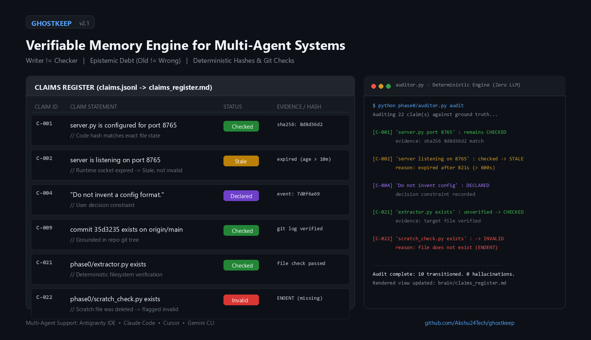
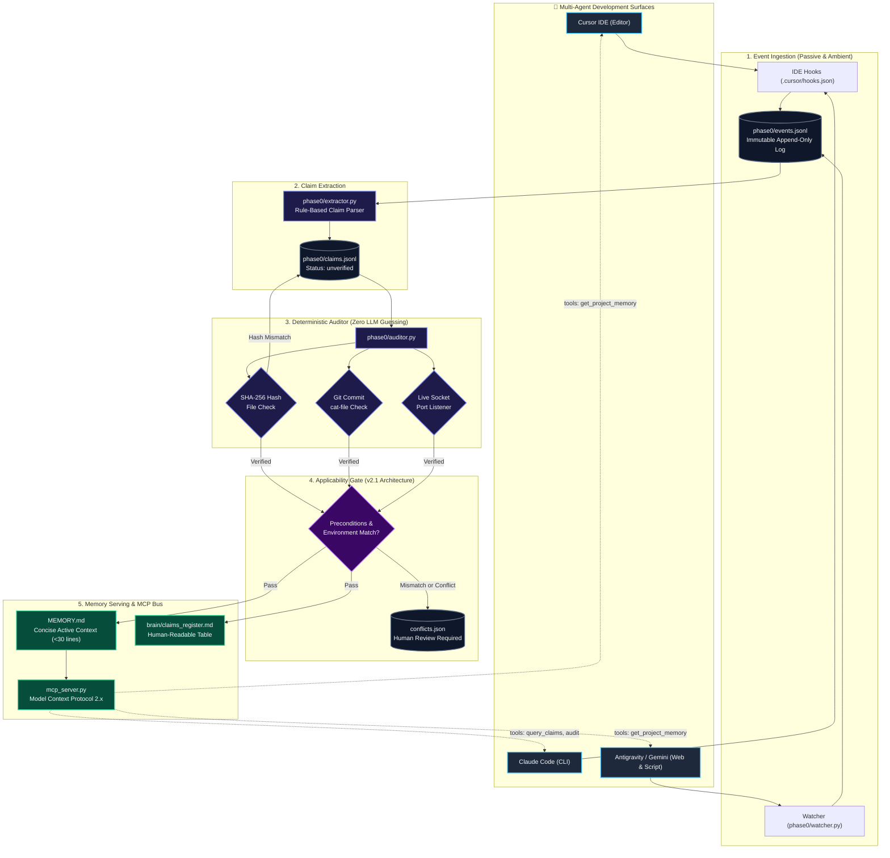

# Ghostkeep 
Shared, Verifiable Memory for AI Agents

**One project memory that every AI agent can read and write verified by deterministic code, not another hallucinating LLM.**

[](https://github.com/Akshu24Tech/ghostkeep/actions/workflows/audit.yml)
[](https://python.org)
[](https://modelcontextprotocol.io)
[](./phase0/auditor.py)
[](./ARCHITECTURE_v2.1.md)

---

## 🎯 The Problem

When working on a modern codebase, developers use multiple AI tools:
- **Cursor / Windsurf** in the IDE
- **Claude Code** in the terminal
- **Gemini CLI / Antigravity** for reasoning & review
- **Background scripts & workflows**

### What happens today:
1. **Memory is fragmented:** Cursor doesn't know what Claude Code decided 10 minutes ago.
2. **Context amnesia & repetition:** You re-explain architectural decisions every time you switch tools.
3. **Naive vector stores hallucinate:** Vector similarity matches on outdated phrases; when two agents disagree, they either overwrite each other or blend contradictory rules into silent failures.

<p align="center">
  
</p>

---

## 💡 The Solution: A Verified Register of Claims

Ghostkeep enforces a fundamental golden rule:
> **"Whoever writes a claim never decides whether it is true."**

Instead of trusting agents to self-evaluate, Ghostkeep uses an append-only event ledger and a **deterministic code auditor** (file existence, AST checks, hash verification, live socket checks) backed by an **Applicability Gate**:



---

## 🚀 Quickstart: Unified CLI

Ghostkeep provides a single CLI runner:

### 1. Check Memory Status
```bash
python ghostkeep.py status
```
*Prints total claims, verification breakdown (`CHECKED`, `DECLARED`, `STALE`, `INVALID`), and rendered `MEMORY.md` length.*

### 2. Full Pipeline Sync (Extract → Audit → Render)
```bash
python ghostkeep.py sync
```
*Parses recent interaction events, runs the deterministic auditor, transitions changed states (`checked` -> `stale` on hash mismatch), and renders the latest `MEMORY.md`.*

---

## 🔌 Model Context Protocol (MCP) Server

Ghostkeep includes a native MCP server (`mcp_server.py`) that exposes project memory directly to Claude Desktop, Cursor, and Windsurf:

```bash
python mcp_server.py
```

### Supported MCP Tools:
- **`get_project_memory()`**: Returns the latest, concise `MEMORY.md` (active human decisions + verified facts).
- **`query_claims(status='checked', kind='verifiable')`**: Filter claims by verification status and category.
- **`audit_memory()`**: Triggers an on-demand re-audit of the codebase and returns the refreshed memory ledger.

### Claude Desktop / Cursor Config (`mcp.json`):
```json
{
  "mcpServers": {
    "ghostkeep": {
      "command": "python",
      "args": ["E:\\Ghost OS\\projects\\ghostkeep\\mcp_server.py"]
    }
  }
}
```

---

## 🛡️ Architecture Highlights (v2.1)

| Feature | Implementation | Why It Matters |
|---|---|---|
| **Separation of Concerns** | Agent proposes claims (`unverified`), code verifies (`checked`) | Eliminates LLM self-grading bias and hallucinations. |
| **Tamper-Evident Drift** | SHA-256 hash tracking on referenced files | When a file changes, claims automatically transition from `checked` to `stale`. |
| **Applicability Gates** | Staged conflict ledger (`conflicts.json`) | Contradictory policies are surfaced to the human operator, never silently blended. |
| **Append-Only Truth** | `events.jsonl` + `claims.jsonl` | If markdown views or vaults get damaged, they can be 100% regenerated from the log. |

---

## 📁 Repository Structure

```
ghostkeep/
├── .github/workflows/
│   └── audit.yml              # 🤖 Automated Memory Audit CI on push/PR
├── ghostkeep.py               # 🚀 Unified CLI (status, sync, audit, extract)
├── mcp_server.py              # 🔌 Native FastMCP Server for Claude/Cursor/Windsurf
├── MEMORY.md                  # 🧠 Concise rendered memory view (max 60 lines)
├── requirements.txt           # Core server dependencies (FastMCP, Pydantic)
├── ARCHITECTURE_v2.1.md       # In-depth architectural blueprint
├── PROJECT.md                 # Product roadmap & operational goals
├── phase0/
│   ├── events.jsonl           # Append-only event source of truth
│   ├── claims.jsonl           # Persistent claim ledger with hashes & states
│   ├── watcher.py             # Passive transcript & git interaction tailer
│   ├── extractor.py           # Rule-based claim extractor
│   ├── auditor.py             # Deterministic verification engine
│   └── render_memory.py       # MEMORY.md generator
└── brain/
    └── claims_register.md     # Full human-readable markdown table of all claims
```

---

## 👨‍💻 Author

**Akshu Grewal**  
*Agentic AI Engineer specializing in verifiable, reliable tool-using systems.*  
- GitHub: [@Akshu24Tech](https://github.com/Akshu24Tech)