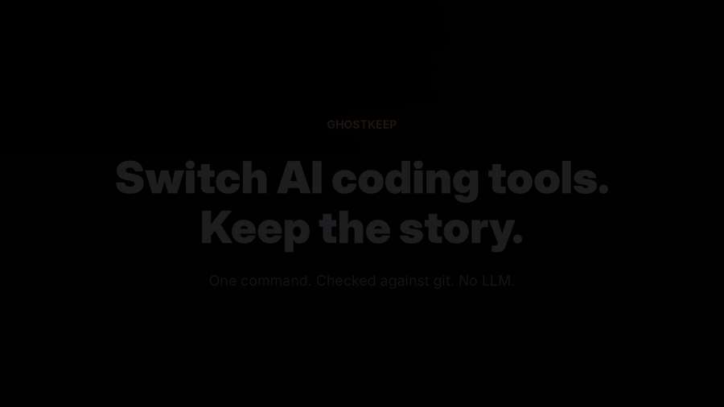

# Ghostkeep

Verified handoffs between free AI coding tools.

[](https://github.com/Akshu24Tech/ghostkeep/actions/workflows/ci.yml)



When you switch from Claude Code to Antigravity CLI (limit hit, missing feature, second opinion),
the files carry over but the story doesn't. The next agent can't tell what was asked, who changed
what, or whether the last agent's claimed work actually happened. Ghostkeep keeps one append-only
ledger per project and checks every claim against git, with no LLM, no API key and no server.

> Status: v0.4.0 (state layer), early and improving. Automatic capture from Claude Code, Antigravity (IDE + CLI) and Codex session logs,
> claims checked against git, decisions captured in your own words, and `ghostkeep handoff`.
> Tests and a labeled eval gate run on Windows, macOS and Linux on every push.

## Install and run

Needs Python 3.10+. No dependencies, no server, no API key.

```bash
# run it once, nothing to install (needs uv)
uvx --from git+https://github.com/Akshu24Tech/ghostkeep ghostkeep handoff

# or install the command
pipx install git+https://github.com/Akshu24Tech/ghostkeep
# or
pip install git+https://github.com/Akshu24Tech/ghostkeep

# reading Codex's older compressed (.zst) sessions is an optional extra
pipx install "ghostkeep[codex] @ git+https://github.com/Akshu24Tech/ghostkeep"
```

```bash
cd your-project
ghostkeep handoff            # read session logs, check claims against git, write .ghostkeep/HANDOFF.md
```

Then tell the next agent: "Read .ghostkeep/HANDOFF.md first." For a browser chat, paste the file in.

`ghostkeep handoff` reads the logs these tools already keep on disk, so no agent has to follow a rule:

| Tool | Log read |
| --- | --- |
| Claude Code | `~/.claude/projects/<repo-path>/<session>.jsonl` |
| Antigravity IDE agent | `~/.gemini/antigravity/brain/<id>/.system_generated/logs/transcript.jsonl` |
| Antigravity CLI | `~/.gemini/antigravity-cli/brain/<id>/.system_generated/logs/transcript.jsonl` |
| Codex | `~/.codex/sessions/YYYY/MM/DD/rollout-*.jsonl` (older `.zst` files need the `codex` extra) |

Expected line counts come from the agent's own edit calls, not its summary. Codex edits through
shell commands, so its files are found in `apply_patch` and file-write commands. Secrets are redacted.
These are internal formats and can change in any update.

Manual logging still works for tools without readable logs:

```bash
ghostkeep init
ghostkeep log --tool antigravity-ide \
  --asked 'Add one line "it is completed" at the end of docs/RESULTS.md.' \
  --claimed "Added the line." --file docs/RESULTS.md:+1-0
ghostkeep check              # exit 1 if any mismatch or orphan change
ghostkeep show
```

```
[BAD] mismatch    e_a7ce363193a7 antigravity-ide
      count_mismatch    docs/RESULTS.md  (expected +1 -0, actual +3 -0)
[???] orphan      no claim
      no_claim          stray.py  (untracked)
```

## Decisions over time

A handoff is a budgeted slice; `.ghostkeep/STATE.md` is the full picture, rebuilt from the ledger on
every `ghostkeep handoff` (or `ghostkeep state`). No LLM, nothing in the ledger is ever rewritten.

- **Decisions stay pinned** while they're in force, however many sessions came after.
- **A decision is replaced only on explicit wording** ("SQLite instead of JSON", "switch from Flask",
  "no longer use Redis") that names something an older decision used. Shared words alone never replace anything.
- **Unfinished work stays open** until a later session finishes it (same request, or same files
  checked against git), not just for the last three sessions.
- **You can correct it**, and your call always wins:

```bash
ghostkeep state                      # what's in force, what's open, what was replaced
ghostkeep retire d_1a2b              # this decision no longer holds
ghostkeep supersede d_1a2b d_9f8e    # d_9f8e replaced d_1a2b
ghostkeep done e_77c1                # that unfinished task is finished
ghostkeep reopen d_1a2b              # undo any of the above
```

## Statuses

| Status | Means |
| --- | --- |
| `verified` | The file changed exactly as the agent claimed, and it's committed |
| `uncommitted` | Matches the claim, not committed yet |
| `mismatch` | The claim doesn't match git, e.g. "added 1 line" but the diff shows 3 |
| claimed but not on disk | The agent said it edited a file and git shows no change: still pending in the IDE, or rejected |
| `orphan` | A file changed and no session claims it |
| `superseded` | A later session changed the same file |

The accept/reject click in an IDE isn't recorded in any session log, so git is the ground truth.
See [docs/LEDGER.md](docs/LEDGER.md) for the ledger format.

## Why

Measured on a real project (10 Nov 2026): after a tool switch, plain agents found *what* changed but
got *who*, *status* or *the task itself* wrong in 4 of 5 answers, and Antigravity CLI confidently
resumed the wrong task after a Claude session was cut off mid-way.

Then the same test with Ghostkeep (11 Nov 2026): Claude cut off mid-task, `ghostkeep handoff` run,
Antigravity CLI told to read `.ghostkeep/HANDOFF.md` first. It named the right task and the
interrupted file, and continued without being re-told.

## Earlier version

The v2.1 "Claims Register" prototype (watcher, extractor, auditor, MCP server) is kept on the
[`legacy`](../../tree/legacy) branch and in this repo's history. v0.1 restarts the code around one
narrower job: checking agent claims about their own work at the moment you switch tools. Ideas
carried over: append-only log, the writer never sets its own status, deterministic checks only,
and decision/preference capture from the user's own words.

## Tests and evals

```bash
python -m pytest -q          # unit tests
python evals/run.py          # 37 labeled cases scored on 17 metrics, writes evals/RESULTS.md
python evals/run.py --gate   # exit 1 if any metric is below target (what CI runs)
python evals/label_real.py   # label Ghostkeep's output on your own sessions, then --score
```

The eval cases are small fake projects with session logs in each tool's real format and the right answer
written down: claimed files and line counts, verdicts, orphans, who changed what, decisions captured,
unfinished work first, plus adversarial cases (planted instructions in an agent's message, secrets,
malformed logs, sessions from another repo). Cases in the `realdata` group reproduce bugs found by
labeling real sessions. Latest numbers: [evals/RESULTS.md](evals/RESULTS.md).
How Ghostkeep scores against an agentic system design review, and what's left:
[docs/DESIGN_AUDIT.md](docs/DESIGN_AUDIT.md).
