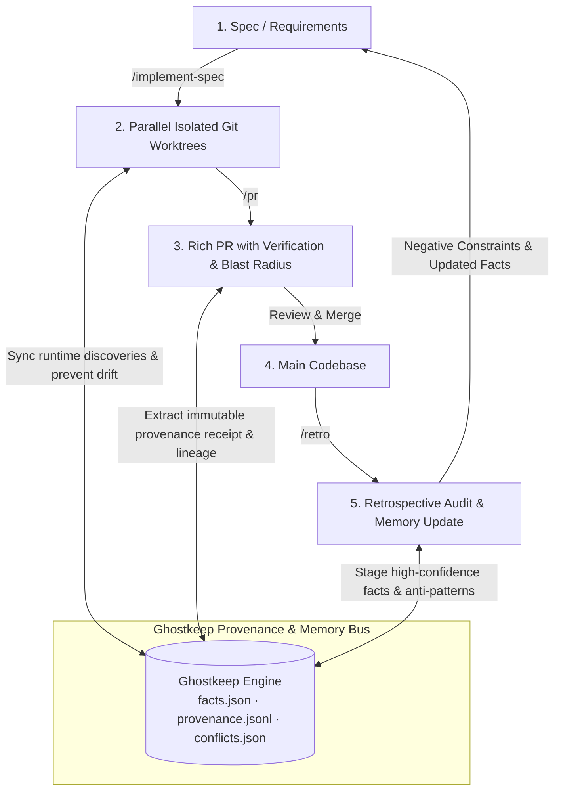

# Closed-Loop Agentic SDLC with Ghostkeep

> **Source Inspiration:** Matt Pocock's 3-Skill Workflow (`/implement-spec`, `/pr`, `/retro`) analyzed by Eric Tech ([YouTube](https://youtu.be/1MNSJhCGMLY)).
> **Core Thesis:** The autonomous coding loop cannot close without an immutable, cross-worktree provenance memory bus. Without it, parallel worktrees develop split-brain amnesia, PRs lack verifiable derivation lineage, and retrospectives bloat markdown rules into prompt degradation.

---

## 1. The Autonomous Coding Loop Paradigm

Modern agentic engineering is shifting from one-shot conversational "vibe coding" to deterministic, closed-loop software development lifecycles (SDLC). Matt Pocock introduced three foundational skills that operationalize this shift:



---

## 2. The 3 Skills & The Missing Memory Layer

While the 3-skill loop is powerful, running it against traditional file systems and stateless LLM sessions exposes critical cognitive failures that **Ghostkeep** directly solves:

### Skill 1: `/implement-spec` (Autonomous Multi-Worktree Execution)
- **What it does:** Reads an architecture spec or design doc, isolates execution inside dedicated `git worktree` branches, runs iterative test-driven development (TDD), and handles task completion without human micromanagement.
- **The Failure Mode (Inter-Worktree Split-Brain):** Git worktrees isolate the filesystem, but they completely isolate agent cognition. If Agent A (building the auth backend in `worktree/auth`) discovers an incompatible JWT library quirk or database lock issue, Agent B (building the API consumer in `worktree/api`) remains completely oblivious until merge time, causing massive merge conflicts and architectural divergence.
- **The Ghostkeep Solution:** Ghostkeep operates as the **inter-worktree shared memory bus**. Both worktree agents connect to the local Ghostkeep MCP server. When Agent A records an environment fact (`add_memory` with high confidence), Agent B immediately queries it via `search_memory` or receives ambient sieve alerts, preventing cross-branch cognitive drift.

### Skill 2: `/pr` (Rich Context PRs with Blast Radius & Verification)
- **What it does:** Runs test suites, analyzes git diffs, quantifies the blast radius of changes, writes evidence-backed PR descriptions, and presents clean commits for review.
- **The Failure Mode (Unverifiable Lineage):** Traditional PR summaries describe *what* changed, but cannot verify *why* or *by whom*. If an autonomous agent refactors a security guardrail, the reviewer has no proof whether that change was explicitly commanded by the user, inferred by a subagent, or hallucinated during a self-healing loop.
- **The Ghostkeep Solution:** Ghostkeep generates an automated **Provenance Receipt (Bill of Materials)** inside the PR. By querying `get_provenance(fact_id)` and reading `provenance.jsonl`, the PR tool embeds exact lineage:
  - Exact `source_agent` (`claude-code`, `gemini-antigravity`, `subagent-tdd-runner`)
  - `source_session_id` tracing back to the raw execution transcript
  - `derivation_chain` linking code edits directly to user prompt requirements or spec sections.

### Skill 3: `/retro` (Closed-Loop Retrospective & Self-Correction)
- **What it does:** Audits the execution transcript, diffs, and test failure history after merging a PR. Extracts recurring mistakes, identifies antipatterns, and updates repository instructions.
- **The Failure Mode (Prompt Bloat & Rule Decay):** Pocock's default pattern writes lessons back into `AGENTS.md` or `CLAUDE.md`. As projects evolve, markdown rules accumulate into hundreds of lines of negative constraints. This causes **prompt degradation**, high input token costs, and rule conflict (where Rule 42 contradicts Rule 8).
- **The Ghostkeep Solution:** `/retro` does not append plain prose to markdown. Instead, it commits structured, vectorless memories to Ghostkeep:
  - High-confidence facts (`confidence: 0.95`, `category: "codebase_rule"`)
  - Staged conflict checks against existing facts
  - Deterministic recall via MCP tools (`search_memory` or ambient sieves) only when the relevant module or task is touched, keeping the baseline prompt light and sharp.

---

## 3. Ghostkeep MCP Integration Contracts

How the 3 skills interface with Ghostkeep's local MCP tools:

### A. During `/implement-spec`: Real-Time Discovery Broadcasting
```json
// Tool Call: add_memory
{
  "key": "postgres_connection_pool_limit",
  "value": "Max pool size must remain at 10 in worker containers to prevent connection exhaustion during parallel worktree test runs.",
  "category": "infrastructure",
  "confidence": 0.95,
  "source_agent": "worktree-worker-db",
  "source_session_id": "session-worktree-db-492a"
}
```

### B. During `/pr`: Generating the Provenance Audit Receipt
```markdown
### 🛡️ Ghostkeep Provenance Receipt
| Component | Modified By | Session Trace | Confidence | Derivation Ancestor |
|---|---|---|---|---|
| `auth/jwt.py` | `claude-code` | `sess-8391` | `1.0` (User Explicit) | Spec #3.2 |
| `db/pool.py` | `worktree-worker-db` | `sess-492a` | `0.95` (Test Discovery) | Fact #postgres_connection_pool_limit |

*All lineage verified via `provenance.jsonl` ledger.*
```

### C. During `/retro`: Retrospective Memory Ingestion
```json
// Tool Call: add_memory
{
  "key": "antipattern_pydantic_v1_validator",
  "value": "Never use @validator from Pydantic V1; this repository has migrated to Pydantic V2 @field_validator. Violations break CI build.",
  "category": "negative_constraint",
  "confidence": 1.0,
  "source_agent": "retro-analyzer",
  "source_session_id": "pr-merge-retro-pr42",
  "derived_from": "fact-pydantic-v2-migration-event"
}
```

---

## 4. Key Architectural Advantages

| Dimension | Raw Pocock 3-Skill Workflow | With Ghostkeep Integration |
|---|---|---|
| **Multi-Worktree Coordination** | Blind isolation; git merge conflicts | Shared real-time memory bus via local MCP |
| **Auditability** | Markdown prose in PR body | Deterministic W3C-PROV derivation ledger (`provenance.jsonl`) |
| **Retrospective Storage** | Ever-growing `AGENTS.md` / `CLAUDE.md` text | Clean vectorless `facts.json` queried on demand |
| **Conflict Management** | Silent overwrites or human git conflicts | Zero silent overwrites via `conflicts.json` staging |
| **Cross-Surface Sync** | Terminal and IDE agents isolated | Unified memory across terminal CLI and IDE sessions |

---

## 5. Related Notes

- [[cross-surface-agent-sync]] — Solving terminal CLI vs. IDE agent amnesia in Gemini Antigravity.
- [[provenance-tracking]] — The W3C PROV-inspired derivation model and audit ledger.
- [[vectorless-memory]] — Why deterministic JSON and file stores outperform vector DBs for ground truth.
- [[conflict-detection-and-resolution]] — Staging multi-agent contradictions without silent overwrites.
- [[mcp-memory-protocol]] — Connecting Ghostkeep to Claude Code, Cursor, and Gemini CLI.
