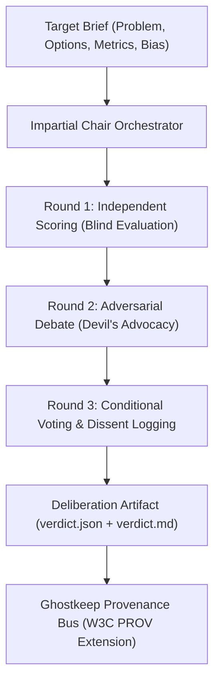

# Deliberative Decision Provenance (Council Architecture)

> **Core question:** *"When multiple specialized agents debate an ambiguous choice, how does memory preserve why the decision won, what failed, and who dissented?"*

---

## 1. The Single-Agent Memory Flaw

Standard AI memory models (and basic key-value stores) treat decisions as flat, static facts:
```json
{
  "fact": "We decided to raise the coaching price from $3k to $6k",
  "source_agent": "claude-code",
  "confidence": 1.0
}
```

### What gets severed:
1. **The rejected alternatives:** Why was Option B (keep at $3k and add upsells) rejected?
2. **The advisor tensions:** Hormozi argued for 10x value packaging, while Buffett flagged customer concentration risk.
3. **The conditional guardrails:** The decision was approved *only under the condition* that churn stays below 5% for 60 days.
4. **The minority dissent:** If things go south 3 months later, no agent remembers the original warnings.

---

## 2. The Roast Room Pattern (Nate Herk / Council Model)

The [[nate-herk-roast-room-ai-board-of-advisors|Roast Room architecture]] (`nateherkai/roast-room`) demonstrates how multi-agent deliberation should be executed and captured:



### The 3 Core Invariants:
1. **Sub-Agent Isolation Over Swarm Chatter:** Each advisor persona (Bezos, Graham, Hormozi, Buffett, Martell, etc.) runs in isolated prompt turns backed by dedicated markdown knowledge bases (`hot.md`, mental models). No persona dilution or crosstalk noise.
2. **The Impartial Chair:** An orchestrator agent that never takes a side, checks brief validity, scores candidate paths, and actively injects devil's advocacy if unanimous agreement forms prematurely.
3. **Structured Council Artifacts:** The council outputs deterministic artifacts:
   - `brief.md`: Raw initial conditions, budget limits, and operator bias.
   - `round-1.md` through `round-3.md`: Chronological debate transcript.
   - `verdict.json`: Scored voting matrix with per-seat weights and conditions.
   - `events.json`: Telemetry event stream.

---

## 3. Ghostkeep Lineage Integration Schema

To incorporate multi-agent deliberation into Ghostkeep’s provenance engine, we extend the `Fact` and `ProvenanceEvent` contracts to represent **Council Decisions**:

```python
class CouncilVote(BaseModel):
    seat_id: str                 # e.g., "buffett", "hormozi", "bezos"
    score: float                 # 0.0 - 10.0
    preferred_option: str        # "Option A", "Option B"
    rationale: str
    attached_conditions: list[str] # ["Churn < 5%", "Payback < 30 days"]

class DeliberativeDecision(BaseModel):
    decision_id: str
    topic: str
    options_considered: list[str]
    winning_option: str
    consensus_score: float
    chair_agent: str             # "claude-code"
    votes: list[CouncilVote]
    dissent_summary: str         # Preserves warnings from dissenting seats
    review_trigger_milestone: str # Condition under which this decision must be re-opened
    source_session_id: str
    created_at: str
```

---

## 4. Why This Matters for Cross-Surface Agent Memory

When an engineer switches from a terminal brainstorming session (e.g., running `/roast-room` in Claude Code) back to their IDE agent (Antigravity or Cursor):
- The IDE agent doesn't just see a raw instruction ("build the $6k checkout page").
- The IDE agent queries Ghostkeep:
  ```bash
  ghostkeep get-provenance decision_pricing_v2
  ```
- Ghostkeep returns the full **Deliberation Lineage**: the winning option, Hormozi's packaging rules, Buffett's risk conditions, and the milestone triggers.
- The IDE agent builds the feature with full awareness of the board's constraints and failure modes.

---

## Related Notes
- [[provenance-tracking]] — The core W3C PROV data model in Ghostkeep.
- [[conflict-detection-and-resolution]] — How opposing agent claims are identified and resolved.
- [[vectorless-memory]] — Why structured JSON/Markdown records outperform vector lookups for decision audits.
